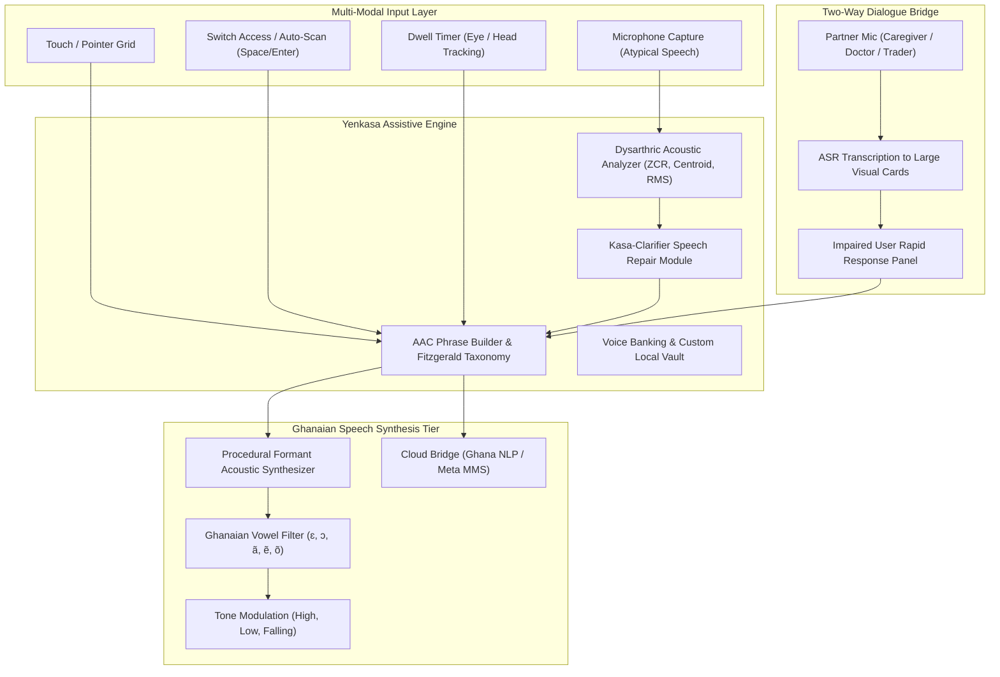

# Yenkasa (Yɛnkasa) — Architectural Specification 🇬🇭

## 1. System Overview

**Yenkasa** (Akan: *"Let's Talk"*) is an Augmentative & Alternative Communication (AAC) platform engineered specifically for people with speech impairment (dysarthria, stroke survivors, cerebral palsy, ALS, apraxia of speech, tracheostomy, and non-verbal autism) in Ghana and West Africa.

---

## 2. The Four Technical Pillars

### Pillar I: The Ghanaian AAC Taxonomy
Traditional Western AAC sets categorize items around foreign concepts (snow, baseball, bagels). Yenkasa categorizes tiles using the standardized **Fitzgerald Key** color taxonomy, tailored to Ghanaian life:
- **Pink (Social & Courtesies)**: *Mema wo akye*, *Akwaaba*, *Medase*, *Me paakyɛw*, *Oyiwala donn*, *Akpe na wò*.
- **Orange (Everyday Foods & Transit)**: *Waakye*, *Jollof*, *Banku*, *Fufu*, *Trotro*, *Circle*, *Kasoa*, *Kejetia*.
- **Green (Actions & Clinical Needs)**: *Nom aduro*, *Frɛ dɔkota*, *Gye me so*, *Tee so*.
- **Blue (Feelings & Body States)**: *Kɔm de me*, *Me ti pae me*, *Awɔ de me*, *Ahuhuro*.
- **Red (Emergency & Urgent Safety)**: *Boa me ntɛm ara!*, *M'ahwe fam*, *Mentumi nnye me home*.

### Pillar II: Indigenous Ghanaian TTS Formant Engine
Low-resource African languages lack native voices in standard Web Speech API implementations on iOS/Android. Yenkasa implements a client-side **formant synthesis engine** modeled after the vocal tract resonances of Ghanaian speakers:
- **Akan Vowels**: Formant pairs for /ɛ/ ($F_1 \approx 580\text{ Hz}, F_2 \approx 1800\text{ Hz}$) and /ɔ/ ($F_1 \approx 550\text{ Hz}, F_2 \approx 950\text{ Hz}$).
- **Tonal Contours**: Frequency ramps for high tone (́), low tone (̀), and utterance-final downdrift.
- **Phonetic Transliteration**: Transforms orthographic tokens (`ky` $\rightarrow$ `ch`, `gy` $\rightarrow$ `j`, `tw` $\rightarrow$ `chw`, `ɖ` $\rightarrow$ `d`, `ʋ` $\rightarrow$ `v`) for cross-browser fallback engines.

### Pillar III: Dysarthric Acoustic Feature Extraction & Speech Repair
For users who can produce vocal sounds but cannot articulate cleanly due to spasticity or muscle weakness:
- **RMS Energy**: Establishes vocal burst duration without requiring standard consonant clarity.
- **Spectral Centroid**: Measures frequency centroid to distinguish open vowel gestures from nasal/closed gestures.
- **Zero-Crossing Rate (ZCR)**: Identifies presence of unvoiced fricatives.
- **Calibration Vault**: 4-point calibration profile maps the user's idiosyncratic vocal range to target Ghanaian vocabulary.

### Pillar IV: Universal Accessibility (WCAG AAA)
- **Single-Switch Auto-Scanning**: Loops through items at user-set speeds (0.8s - 4.0s). Activates via Spacebar, Enter, or external Bluetooth switches.
- **Dwell Clicking**: Simulates eye-gaze tracking. Resting cursor or head pointer on a tile for 1.2s triggers speech.
- **High-Contrast Themes**: Standard, OLED Dark, and Yellow-on-Black (optimal for visual impairments).
